<p align="center">
  <a href="https://ankushdutta.in">
    
  </a>
</p>

<p align="center">
  <a href="https://ankushdutta.in"></a>
  <a href="https://ankushdutta.in/Ankush_Dutta_CV.pdf"></a>
  <a href="https://scholar.google.com/citations?user=D3RsdlsAAAAJ"></a>
</p>

<p align="center">
  
</p>

<br/>

## `$ whoami`

<table>
<tr>
<td width="60%" valign="top">

I take models out of notebooks and turn them into things people can use: **retrieval-augmented tutors**, **LLM screening pipelines**, and **neural networks squeezed onto microcontrollers**.

- 🎓 **B.Tech CSE (AI/ML)**, UEM Kolkata · CGPA **9.32**
- 📄 **4 peer-reviewed papers**, IEEE & Springer
- 🎤 **Oral talk**, COMSYS 2026, Prague
- 💼 Former **Software Development Intern** at Alpha Torana
- 🟢 **Open to SDE / ML Engineer roles**, Kolkata or remote

</td>
<td width="40%" valign="top">

```yaml
focus:
  - RAG & LLM systems
  - Computer vision
  - Edge / TinyML
building_with:
  - Python · PyTorch · TensorFlow
  - FastAPI · React · PostgreSQL
currently:
  - shipping case studies
  - writing about edge AI
```

</td>
</tr>
</table>

<br/>

## 🔭 Featured work

<table>
  <tr>
    <td width="50%" valign="top">
      <a href="https://ankushdutta.in/projects/hirelens"></a>
      <h3>Hirelens</h3>
      <sub>LLM-powered resume screening: async extraction, per-criterion scoring with strict JSON schemas, and natural-language candidate search.</sub>
      <br/><br/>
      
      
      
      <br/><br/>
      <a href="https://ankushdutta.in/projects/hirelens"><b>Case study →</b></a>
    </td>
    <td width="50%" valign="top">
      <a href="https://ankushdutta.in/projects/studybuddy-ai"></a>
      <h3>StudyBuddy AI</h3>
      <sub>Conversational RAG tutor with multi-turn memory and quiz-based weak-area diagnosis.</sub>
      <br/><br/>
      
      
      
      <br/><br/>
      <a href="https://ankushdutta.in/projects/studybuddy-ai"><b>Case study →</b></a>
    </td>
  </tr>
  <tr>
    <td width="50%" valign="top">
      <a href="https://ankushdutta.in/projects/edge-aqi"></a>
      <h3>Real-Time Edge AQI</h3>
      <sub>Quantized neural network running directly on an Arduino Uno with MQ-135 & DHT11 sensors, with inference in under 200 ms. <i>Springer ICCDC 2025.</i></sub>
      <br/><br/>
      
      
      
      <br/><br/>
      <a href="https://ankushdutta.in/projects/edge-aqi"><b>Case study →</b></a>
    </td>
    <td width="50%" valign="top">
      <a href="https://ankushdutta.in/projects/gi-disease-classification"></a>
      <h3>GI Disease Classification</h3>
      <sub>EfficientNet-B0 + Squeeze-and-Excitation attention on endoscopic images: 88.55% accuracy, macro F1 0.89 across 8 classes. <i>COMSYS 2026, oral.</i></sub>
      <br/><br/>
      
      
      <br/><br/>
      <a href="https://ankushdutta.in/projects/gi-disease-classification"><b>Case study →</b></a>
    </td>
  </tr>
</table>

<details>
<summary><b>📑 All publications</b></summary>
<br/>

| Year | Paper | Venue |
|:---:|---|---|
| 2026 | Deep-Learning Decision Support for GI Disease Diagnosis Using Endoscopic Images | **COMSYS 2026, Prague (oral)** · Springer LNNS, in press |
| 2025 | Hybrid CNN-LSTM for Multi-step AQI Forecasting | IEEE ICAIET 2025 |
| 2025 | Real-Time AQI Detection via Edge AI on Arduino Uno | Springer ICCDC 2025 |
| 2025 | YOLOv9 Fine-tuning for Precision Forestry Monitoring | Springer CICBA 2025 |

</details>

<br/>

## 🛠 Toolbox

<p align="center">
  
</p>

<br/>

## 📈 Activity

<p align="center">
  
  
</p>

<p align="center">
  
</p>

<br/>

<p align="center">
  <sub><i>"All models are wrong, but some are useful." — George Box</i></sub>
</p>
